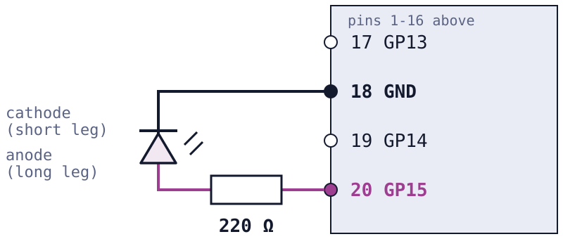

<!-- _class: title -->
<!-- _header: "" -->
<!-- _footer: "" -->
<!-- _paginate: false -->

# From source code to a running embedded system

## Embedded and IoT Intelligent Systems Programming · Lab 1 · 16 October 2026


---

# One program, followed all the way

```text
 HOST (laptop)                          TARGET (Pico 2 WH)

 main.c ─► compiler ─► ELF ─► UF2  ───►  flash ─► CPU ─► GPIO ─► LED
```

> Follow a program from source code to observable behaviour on real hardware.

---

# The path of this lab

```text
BUILD ─► INSPECT ─► FLASH ─► OBSERVE ─► MODIFY ─► MEASURE
```

| Step | Handout |
| --- | --- |
| Set up the environment | Part 0 |
| Build, inspect | Parts 1 and 2 |
| Flash, observe | Part 3 |
| Modify | Part 4 |
| Measure | Part 5 |

---

<!-- _class: prose -->
<!-- _header: "Lab 1 · Vocabulary 1 of 8" -->

# Compilation

A processor does not understand C. It executes **machine code**, a sequence of numbers that encode very simple operations, such as adding two values or reading a memory address. A **compiler** translates the C source files into machine code, and a **linker** joins the translated pieces into one program.

This was already done in earlier courses: running `gcc` on a laptop and then executing the result is exactly this process.

```text
main.c ──► compiler ──► machine code
```

---

<!-- _class: prose -->
<!-- _header: "Lab 1 · Vocabulary 2 of 8" -->

# Cross-compilation

Machine code belongs to one processor family. A program compiled for the x86-64 processor of a laptop cannot run on an Arm Cortex-M33, because the two understand different instructions.

A **cross-compiler** runs on one machine, the **host**, but produces code for a different machine, the **target**. In this lab the host is the computer used to build the program, and the target is the chip on the Pico.

```text
 host ──► cross-compiler ──► machine code for the target
```

---

<!-- _class: prose -->
<!-- _header: "Lab 1 · Vocabulary 3 of 8" -->

# Microcontroller and board

The RP2350 is a **microcontroller**: a single chip that contains the processor, a few hundred kilobytes of RAM, and the circuits that talk to the outside world. The memory that stores the program is a separate flash chip, connected to the microcontroller on the board.

The **Raspberry Pi Pico 2 WH** is the board built around the RP2350. It adds the USB connector, the power regulation, the flash chip and the pins along the edges. The H means that the pin headers are already soldered, and the W means that the board also carries a wireless chip, which is not used in this lab.

---

<!-- _class: prose -->
<!-- _header: "Lab 1 · Vocabulary 4 of 8" -->

# Firmware

**Firmware** is the program that lives inside an embedded device. There is no disk, no login and no program launcher: the code is stored in flash memory, and the processor starts executing it as soon as power arrives.

In this course the firmware is built on **Zephyr**, a real-time operating system that provides a kernel, drivers and libraries. The application code, `main.c`, is linked together with the parts of Zephyr it needs, and the result is one image that is written to the board.

---

<!-- _class: prose -->
<!-- _header: "Lab 1 · Vocabulary 5 of 8" -->

# Flash memory and flashing

**Flash memory** keeps its content when the power is off, unlike RAM, which does not keep its data without power. The program therefore has to be stored in flash.

**Flashing** means writing the image into that memory. On the Pico the writing is done by the **boot ROM**, a small program stored in the chip at the factory, which can present the board to the computer as a USB drive. Once the image is written, the board runs it every time it is powered, until a new image replaces it.

---

<!-- _class: prose -->
<!-- _header: "Lab 1 · Vocabulary 6 of 8" -->

# GPIO

**GPIO** stands for general-purpose input/output. A GPIO is a pin whose role is decided by software. When configured as an output, the program sets it to a high voltage (3.3 V) or to a low voltage (0 V). When configured as an input, the program reads which of the two voltages is present.

Connecting an LED, through a resistor, to an output pin lets the program turn the LED on and off. This is the observable result of the whole lab: a line of C code that changes a voltage on a pin.

---

<!-- _class: prose -->
<!-- _header: "Lab 1 · Vocabulary 7 of 8" -->

# Two numbers for every pin

Each GPIO pin has two numbers: the **physical pin**, its position along the edge of the board (1 to 40), and the **GPIO name**, such as GP15, which the software uses. Power and ground pins have a position but no GPIO name.

The two numbers are unrelated. The LED is driven by GP15, which is physical pin 20, while physical pin 15 is GP11. Mixing them up is an easy wiring mistake.

```text
physical pin 20  =  GP15   (LED, through the resistor)
physical pin 18  =  GND
```

---

<!-- _class: prose -->
<!-- _header: "Lab 1 · Vocabulary 8 of 8" -->

# Serial console and logging

An embedded board has no screen. To see what the program is doing, it sends text over a communication line, and the computer receives that text with a terminal program.

On the Pico this line is a **virtual serial port** that runs over the same USB cable used for flashing. **Logging** means printing short, timestamped messages from the code at the points that matter. It is often the first way, and sometimes the only way, to see inside a running program.

---

# Host and target side by side

| | Host | Target |
| --- | --- | --- |
| Machine | laptop | Raspberry Pi Pico 2 WH |
| Processor | x86-64 or Arm laptop CPU | RP2350, Arm Cortex-M33 |
| Runs | editor, compiler, terminal | firmware: application + Zephyr RTOS |
| Memory | gigabytes | 520 KB RAM, 4 MB flash |

The compiler runs on the host side (here, inside the build container).
The firmware runs on the target. The Pico builds nothing.

---

<!-- _class: do -->

# Which compiler is this?

```bash
./bin/course uname -m
./bin/course arm-zephyr-eabi-gcc -dumpmachine
```

- 1st: where the compiler runs (the container)
- 2nd: what the code is built for

<p class="meta">Handout · Part 1</p>

---

# The software stack

<div class="columns"><div>

```text
  Application   main.c
  ─────────────────────
  Zephyr API    k_msleep, GPIO
  ─────────────────────
  Zephyr kernel and drivers
  ─────────────────────
  RP2350
```

</div><div>

Build tools

- `west`
- CMake
- Ninja
- GCC (cross)

All run in the course container.

</div></div>

DeviceTree and Kconfig: Lab 3.

---

# A minimal Zephyr application

```text
app/
├── CMakeLists.txt     what to build
├── prj.conf           which Zephyr features to include
├── boards/            which pin the LED is on
└── src/
    └── main.c         the program
```

One file, one role. Nothing else is needed to produce a firmware.

---

# main.c

```c
for (uint32_t n = 0;; n++) {
    uint32_t start = k_cycle_get_32();

    gpio_pin_toggle_dt(&led);
    k_msleep(BLINK_PERIOD_MS);

    uint32_t us = k_cyc_to_us_near32(k_cycle_get_32() - start);
    LOG_INF("toggle %u: asked %d ms, measured %u us", n, BLINK_PERIOD_MS, us);
}
```

Ordinary C, compiled against Zephyr. `led` comes from the devicetree alias `led0`.

---

# What happens during a build

```text
main.c ──► compiler ──► main.o ─┐
Zephyr sources ► compiler ► *.o ─┼─► linker ──► zephyr.elf
libraries ───────────────────────┘
```

```text
west build ─► CMake ─► Ninja ─► compiler and linker
 (entry)     (plan)   (runs it)
```

CMake plans the build once. Ninja runs only what changed.

---

# ELF contains more than what we flash

`zephyr.elf` is the executable of the toolchain: machine code, symbols,
sections and debug information. The boot ROM accepts a flash image, not an ELF.

```text
linker ─┬─► zephyr.elf ─┬─► zephyr.bin   raw bytes
        │               ├─► zephyr.hex   bytes as text, with addresses
        │               └─► zephyr.uf2   format of the Pico boot ROM
        └─► zephyr.map   report: where the linker placed everything
```

---

<!-- _class: prose -->

# Reading the size output

The `size` tool splits the program into three parts. `text` is the code and the read-only data, stored in flash. `data` is the set of variables that start with a value other than zero: the initial values are stored in flash and copied into RAM at start-up. `bss` is the set of variables that start at zero, and they take space in RAM only.

Flash used is therefore about `text + data`, and RAM used is about `data + bss`. The last column, `dec`, is only the sum of the three and describes neither memory.

---

<!-- _class: do -->

# Inspect before flashing

```text
$ arm-zephyr-eabi-readelf -h zephyr.elf | grep -E 'Class|Machine'
  Class:                             ELF32
  Machine:                           ARM
$ arm-zephyr-eabi-size zephyr.elf
   text    data     bss     dec
  55924     372   14430   70726
```

Which architecture? Flash used = `text` + `data`: how much of the 4 MB?

<p class="meta">Handout · Part 2</p>

---

<!-- _class: do -->

# Bill of materials

| Item | Qty | Note |
| --- | ---: | --- |
| Raspberry Pi Pico 2 WH | 1 | headers soldered |
| Micro-USB data cable | 1 | charge-only cables fail |
| Breadboard | 1 | the Pico plugs into it |
| LED, any colour | 1 | long leg = anode |
| Resistor 220 Ω | 1 | limits the LED current |

<p class="meta">Handout · Part 3</p>

---

<!-- _class: do -->

# Wiring

**GP15 is physical pin 20.** Physical pin 15 is GP11.



<p class="meta">Handout · Part 3, before flashing</p>

---

<!-- _class: do -->

# From file to hardware

1. Hold BOOTSEL, plug in the USB cable.
2. The boot ROM runs and the Pico appears as the USB drive `RP2350`.
3. Copy `zephyr.uf2` to the drive.
4. The boot ROM writes it to flash and resets the chip.
5. The program runs.

<p class="small">A blank board shows the drive without the button. After its first program, hold BOOTSEL at every plug-in.</p>

<p class="meta">Handout · Part 3</p>

---

# Observing a running program

<div class="columns"><div>

**Physical**

The LED on GP15.

**Software**

USB serial and logging.

</div><div>

```text
[00:00:03.014,000] <inf> lab01:
  toggle 0: asked 1000 ms,
  measured 1000045 us
```

</div></div>

Embedded software needs observability. Without these two channels, the board is a closed box.

---

<!-- _class: do -->

# Change one line

```c
#define BLINK_PERIOD_MS 1000   →   #define BLINK_PERIOD_MS 250
```

```text
 EDIT ──► BUILD ──► FLASH ──► OBSERVE
  ▲                              │
  └──────────────────────────────┘
```

Source changed, binary changed, flash changed, behaviour changed.
This loop repeats in every lab.

<p class="meta">Handout · Part 4</p>

---

<!-- _class: do -->

# Requested time and actual time

```text
k_msleep(1000);

asked:    1000 ms
measured: 1000043 us
```

The interval starts before the toggle and ends after the sleep returns, so it covers both.

Collect 20 lines. Record the smallest and largest error, and one reason for it.

<p class="meta">Handout · Part 5</p>

---

<!-- _class: do -->

# Measure instead of assuming

How long does one `gpio_pin_toggle_dt()` take?

```text
one operation      too short for a reliable single reading
1000 operations    measurable
total / 1000       cost of one
```

Wrap the loop with `k_cycle_get_32()` and `k_cyc_to_ns_near32()`
(`k_cyc_to_us_near32()` gives microseconds).

<p class="meta">Handout · Part 5, challenge</p>

---

# The complete path

```text
 main.c
   ▼
 west ─► CMake ─► Ninja
   ▼
 arm-zephyr-eabi-gcc
   ▼
 zephyr.elf ─► zephyr.uf2
   ▼
 RP2350 boot ROM ─► flash
   ▼
 CPU executes ─► GPIO ─► LED
```

---

# What this lab established

- The host is not the target; a cross-compiler bridges them.
- A build turns source into target code, and the artefacts can be inspected.
- Firmware becomes observable behaviour through the LED and the log.
- Embedded development is an edit, build, flash and observe loop.

**Lab 2:** several activities share one processor, each with its own timing requirement.
